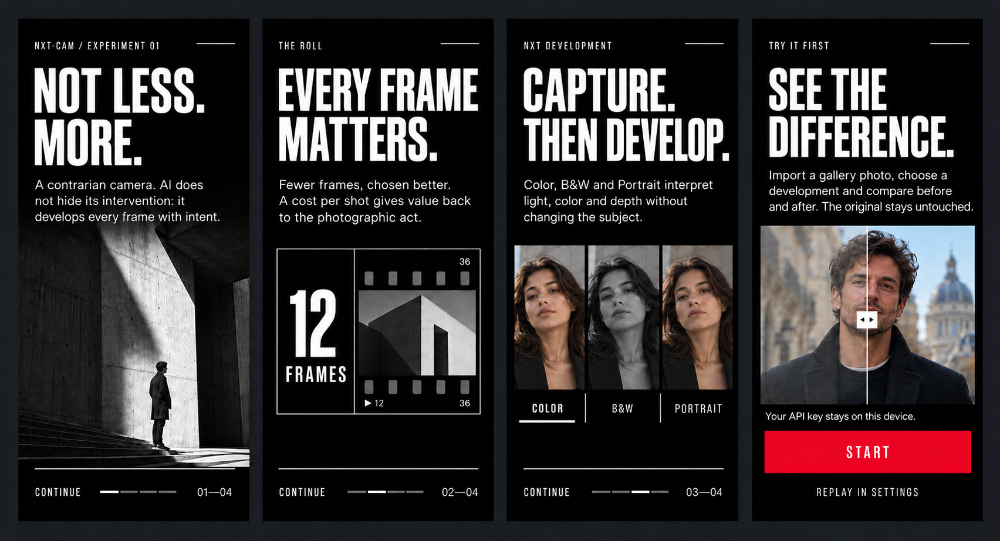

# NXT-CAM

> **NOT LESS. MORE.**
>
> A contrarian experiment in computational photography.



## Download

[**Download NXT-CAM 2.6.0 for Android**](https://github.com/noisystyle/NXT-CAM/releases/download/v2.6.0/NXT-CAM-debug.apk)

The downloadable APK is an experimental debug build for sideloading and testing. Android may ask
you to allow installation from the browser or file manager used to open it. NXT-CAM is BYOK: the
APK contains no API key, so each tester must provide a personal OpenAI key in **Settings**.

> **Migrating from 2.5.1 or earlier:** version 2.6.0 adopts the new application ID
> `io.github.noisystyle.nxtcam`, so Android installs it as a separate app. Open the NXT roll and
> allow photo access once to keep earlier NXT-CAM photographs visible, then re-enter the API key.
> Remove the legacy installation only after checking the new app.

NXT-CAM starts with a simple question: if every smartphone already has a capable camera, how far
can a photograph go when AI is used as a true digital development process?

Many camera apps pursue an invisible result, a *no-filter* aesthetic and maximum naturalism.
NXT-CAM deliberately explores the opposite direction: recognizable, cinematic and assertive
development that aims to give the frame a strong identity while preserving its people, objects
and meaning.

Every API development has a cost. NXT-CAM treats that as more than a constraint: it gives value
back to the individual frame, much like a limited roll of film made every shutter press matter.

## The vision

NXT-CAM is also a personal experiment in where smartphone photography might go next. Could
better processing help a phone with a single camera, modest optics or a smaller sensor produce
more compelling photographs? Could it make much stronger zoom useful while retaining good
image quality? And where would recovered detail end and AI reconstruction begin?

These are questions behind the project, not capabilities promised by the current app. NXT-CAM
does not currently guarantee lossless extreme zoom, flagship-level results from any camera, or
faithful recovery of details that were never captured. It is a way to explore that possible
future through a working photographic experiment.

- **Start with a photograph.** Development begins with a captured or imported image. The AI is
  instructed to preserve identity, anatomy, geometry and scene detail; those are processing
  goals, not a guarantee that a generative image model will never alter a detail.
- **A bold result, never an arbitrary one.** Local contrast, color, atmosphere, grain, light,
  depth separation and bokeh are used decisively but adapted to the real subject.
- **Every frame matters.** A monthly allowance and per-photo cost make photography less automatic
  and more intentional.
- **Experiment before shooting.** Existing gallery images can be developed while preserving the
  source and showing a before/after comparison.

### Why deliberately strong processing?

The processing is intentionally pushed a little further. Many camera apps pursue the most
natural-looking shot or the *no-filter* aesthetic; NXT-CAM explores a visibly developed image
with a distinct cinematic character.

Each API development costs money. The aim is to make that intervention visibly and creatively
worthwhile, so the money spent produces a meaningful visual change. More processing is
not automatically better photography: this is a creative choice for the experiment, and the
result will not suit every photograph or every taste.

That cost also invites a slower approach: choose a frame, decide how to develop it, and give it
attention, much as you would with a limited roll of film.

## Features

### Camera

- front and rear cameras;
- `1×`, with optional `0.6×` ultra-wide and `2×` main-sensor crop controls when exposed by the
  device, plus pinch-to-zoom within its available range;
- tap-to-focus, focus-point metering and vertical-swipe exposure compensation;
- AF/AE lock with a long press;
- `OFF`, `AUTO` and `ON` flash modes;
- rule-of-thirds grid and stabilized level for both horizon and overhead shots;
- volume-button shutter, precise haptics and immediate capture feedback;
- manufacturer CameraX HDR and night extensions when available;
- edge-to-edge interface for phones, landscape use and foldable devices.

### NXT Development

- `HIGH` and `MAX` quality;
- `COLOR`, `B&W` and `PORTRAIT` profiles;
- subject-aware treatment for people, animals, food, products, close-ups, landscapes,
  architecture and night scenes;
- pronounced bokeh for portraits and close subjects, conservative depth treatment for landscapes
  and architecture;
- local contrast, depth, grain and cinematic color grading;
- selective subject polish with instructions against plastic skin or changes to face, body,
  age, complexion, animal breed, ingredients, text or geometry;
- explicit constraints against inventing people, objects or scene elements;
- a persistent WorkManager queue that continues in the background and can recover after network
  loss, process termination or device restart.

### NXT Roll

- vertical timeline grouped by month with sticky headings;
- grid of photographs developed inside the app;
- viewer with swipe navigation, double tap, zoom and pan;
- share and delete actions;
- development progress shown directly on the thumbnail;
- import from the system gallery;
- source preserved and before/after comparison for imported photographs.

### Cost and privacy

- **BYOK** (*bring your own key*): every user supplies a personal OpenAI API key;
- key encrypted on-device with Android Keystore;
- no key embedded in source code or APKs;
- optional monthly spending limit;
- estimated remaining developments and days until reset;
- actual cost when returned by the service, local estimate otherwise;
- monthly summary, average cost per photo and CSV export;
- direct device-to-OpenAI requests, with no NXT-CAM proxy server.

## Requirements

- a CameraX-compatible Android device running **Android 10 (API 29) or newer**;
- a personal OpenAI API key with access to a supported image model;
- an Internet connection for photographic development.

Android Studio and the Android SDK are needed only to build the app from source, not to install
the downloadable APK.

### Device compatibility

NXT-CAM is not restricted to Samsung or foldable phones, and multiple rear cameras are not a
requirement. AI development runs through the OpenAI API, rather than an on-device AI model;
there is no requirement for a flagship AI processor. The phone still handles capture, image
preparation and display, so performance and memory use can vary.

Development and testing have focused on a Samsung Fold and Android emulators. Broader
compatibility across manufacturers, Android versions and lower-end phones is still being
verified. **Android 10 or newer is a minimum requirement, not a guarantee that every device
has been tested or that every camera feature will work.** There is no iOS version.

HDR, night mode, ultra-wide access and the available zoom range depend on the capabilities the
manufacturer exposes through CameraX. A phone may have extra lenses in its stock camera app
that are unavailable to NXT-CAM. Unsupported lens controls are hidden; if an OEM extension
fails to bind, the app attempts to use the standard camera pipeline.

The `2×` control is a crop, not a promise of optical zoom or lossless magnification. Importing
an existing photograph also lets you explore development using an image captured with another
camera app.

When reporting a compatibility issue, include the phone model, Android version, NXT-CAM
version and steps to reproduce it. See [CONTRIBUTING.md](CONTRIBUTING.md).

## Build and install

The Android application ID is `io.github.noisystyle.nxtcam`.

Clone the project and open it in Android Studio, or use Gradle:

```bash
git clone https://github.com/noisystyle/NXT-CAM.git
cd NXT-CAM
./gradlew assembleDebug
./gradlew installDebug
```

On first launch:

1. complete the onboarding;
2. open **Settings**;
3. enter a personal API key;
4. optionally set a monthly limit in USD.

Run the project checks with:

```bash
./gradlew assembleDebug lintDebug
```

## API key and BYOK model

The key is entered at runtime, encrypted with Android Keystore and read only by the worker making
the request. It is never written to logs, file names or photo metadata.

A secret stored on a client device cannot offer the same guarantees as a key held by a backend.
For testing NXT-CAM:

- create a dedicated project and API key;
- configure budgets and alerts on the provider platform as well;
- never distribute an APK containing a preconfigured key;
- revoke the key if the device is lost or transferred.

## Resolution and cost

In `HIGH`, NXT-CAM prepares input up to 2048 px on the long edge and requests output up to 1536
px. In `MAX`, it prepares input up to 3072 px and requests output up to 2560 px while preserving
the source aspect ratio with service-compatible dimensions.

Every development uses paid APIs. Pricing, model availability, latency and supported output sizes
may change; always check the current terms and limits of your OpenAI account. The in-app limit is
an additional safeguard and does not replace provider-side billing controls.

## Project status

NXT-CAM is an independent, evolving experiment and is not intended to replace the system camera
at this stage. It is not an official product and is not affiliated with, sponsored by or endorsed
by OpenAI, Google, Samsung or any device manufacturer.

The repository contains no API keys, personal photographs or cost logs. Compiled test APKs are
distributed only through [GitHub Releases](https://github.com/noisystyle/NXT-CAM/releases).

## Support the experiment

If NXT-CAM is useful or inspiring, you can support its continued development:

[**Buy me a coffee**](https://buymeacoffee.com/marcoprattv)

## Contributing

Issues and proposals are welcome. Read [CONTRIBUTING.md](CONTRIBUTING.md) before submitting a
change. For security concerns, follow [SECURITY.md](SECURITY.md).

## License

Released under the [MIT License](LICENSE).
